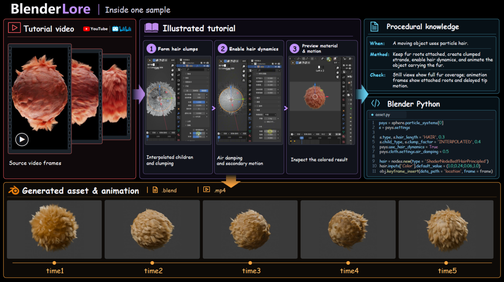
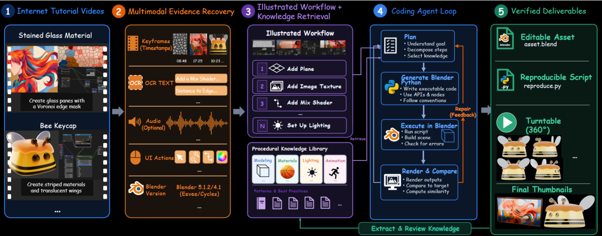
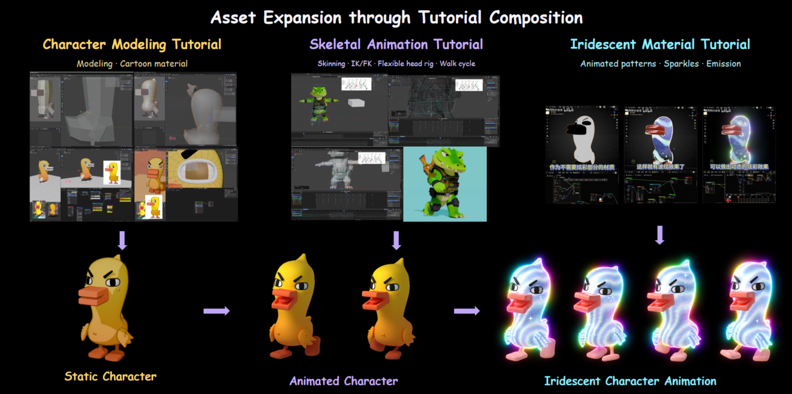

English | <a href="README_zh-CN.md">简体中文</a>

<h2 align="center">BlenderLore: Learning 3D Coding from Internet Tutorial Videos</h2>

<p align="center">
  <strong>If you like our project, please give us a star ⭐ on GitHub for the latest update.
</strong>
</p>

<p align="center">
  <a href="https://blenderlore.github.io/"></a>
  <a href="https://github.com/FreedomIntelligence/BlenderLore"></a>
  <a href="https://huggingface.co/datasets/FreedomIntelligence/BlenderLore"></a>
  
</p>

## 🔭 Overview

BlenderLore is a dataset and pipeline for acquiring and reusing procedural knowledge from internet tutorial videos for 3D coding. It converts video evidence into illustrated tutorials, reconstructs editable assets in Blender Python, and extracts reviewed methods for future creation tasks. The collection contains **about 22K project instances associated with over 3K tutorial videos** from YouTube and Bilibili.

**Generalization is central to BlenderLore.** Executing code and inspecting geometry, appearance, and motion ground the inferred methods in concrete implementations. Agents can then retrieve, adapt, and combine methods from different tutorials for new goals. **BlenderLore Skill** packages the reconstruction workflow and procedural knowledge library for existing coding agents; knowledge accumulates externally without updating model parameters.



*A complete example: dynamic fur. Illustrated steps connect the source video to executable reconstruction and reusable procedural knowledge.*

## 🧩 Method



1. **Recover illustrated workflows.** Align video frames, narration, on-screen text, and interface changes into ordered steps, recording inputs, operations, parameters, and intermediate results.
2. **Ground methods in source assets.** Use creator-provided projects when available, repair missing components, and connect tutorial steps to concrete implementations.
3. **Reconstruct and inspect.** Retrieve relevant knowledge, generate Blender Python, execute and render the scene, and repair discrepancies in geometry, appearance, or motion.
4. **Review and retain knowledge.** Record each method's source, retrieval keywords, applicability, implementation excerpt, and checks for the intended result. Human experts review the resulting assets.
5. **Adapt and combine.** Reuse methods across tutorials to create new assets and expand the procedural knowledge library.

## Generalizing Beyond Tutorials



BlenderLore creates a walking iridescent Duck GiGi by combining three tutorials: a static character modeling workflow, a rigging and walking method transferred from a baby crocodile, and an iridescent material. The reusable unit is a construction method, allowing agents to adapt and combine knowledge beyond the demonstrated assets.

## 🎁 What You Get

<table>
<tr>
<td width="33%" valign="top">

### 01 · An End-to-End Agent Pipeline

Each run recreates a tutorial workflow and delivers an editable Blender project, a reproduction script, renders, and validation results.

- Editable Asset — `asset.blend`
- Reproduction Script — `reproduce.py`
- Materials & Node Graphs
- Final Render
- Multi-View Renders
- Animation
- Agent Log

</td>
<td width="33%" valign="top">

### 02 · A High-Quality 3D Dataset

About 22K project instances associated with over 3K tutorial videos, built through collection, repair, reconstruction, and cross-tutorial adaptation and composition. Human experts manually check every final asset file.

</td>
<td width="33%" valign="top">

### 03 · A Reusable Procedural Knowledge Library

Reviewed entries record their source, applicability, implementation, and checks. BlenderLore Skill supplies this library and workflow guidance so coding agents can retrieve, adapt, and combine methods for new 3D tasks.

</td>
</tr>
</table>

## 🚀 Quick Start

### 1. Install prerequisites

Install Python 3.10+, Blender, and FFmpeg (including `ffprobe`), with Blender and FFmpeg on `PATH`. Commands below target macOS/Linux; on Windows, use Linux Python and Blender in WSL. Replace example paths with your own.

```bash
git clone https://github.com/FreedomIntelligence/BlenderLore.git
cd BlenderLore
python3 -m venv .venv
source .venv/bin/activate
python -m pip install -r requirements.txt
```

For Codex, install and sign in to Codex CLI using the [official documentation](https://developers.openai.com/codex/cli/), and ensure the client can run `codex`.

### 2. Install Skills

Run from the repository root to install the Skill into the current user's Codex environment:

```bash
mkdir -p "$HOME/.agents/skills"
ln -s "$PWD/skills/blender-pipeline" "$HOME/.agents/skills/blender-pipeline"
```

### 3. Configure rendering

Cycles uses the CPU by default. Omit the Blender path setting if Blender is already on `PATH`.

```bash
export BLENDER_PIPELINE_BLENDER=/path/to/blender
export VIDEO2BLENDER_CYCLES_BACKEND=CPU
```

For GPU rendering, replace `CPU` with the appropriate backend: `OPTIX` or `CUDA` for NVIDIA, `METAL` for Apple Silicon, `HIP` for AMD, or `ONEAPI` for Intel.

### 4. Configure inputs and outputs

Keep input files on your computer. For API mode, enter their paths in the terminal launch command in step 5; for Codex, provide paths or links directly in the client's chat composer.

| Input | API argument | Provide in Codex |
| --- | --- | --- |
| Local video | `--video-file` | Absolute path to the video |
| Video URL | `--video-url` | Full HTTPS video URL |
| Markdown tutorial | `--tutorial` | Absolute path to the `.md` file |

Markdown tutorials need numbered operations and their referenced images. Text-only tutorials also require a final reference image.

Choose a new or empty output directory outside the repository: use `--output-dir` in API mode, or specify it in the Codex conversation. Output formats are fixed; main files appear as their corresponding stages complete:

```text
run_001/
  tutorial.md             # Illustrated tutorial
  reproduce.py            # Blender Python code
  asset.blend             # Editable project
  render.png              # Rendered image
  six_views/              # Static multi-view renders, when applicable
  final_effect.mp4        # Animation or turntable video, when applicable
  pipeline_review.json    # Review results
```

### 5. Start with API / Codex

#### API

Open a terminal at the repository root and run this command for first-time setup:

```bash
python run_api.py --configure --config "$HOME/.config/blender-pipeline/pipeline.json"
```

At the terminal prompts, enter an HTTPS API endpoint ending in `/chat/completions` and your API key. The endpoint is saved in the `endpoint` field of `~/.config/blender-pipeline/pipeline.json`; the key is saved in `model_api_key` in the same directory. Edit these files to change the configuration later.

Launch from the same terminal, replacing the input path and output directory with your own. Use the corresponding argument from step 4 for other input types:

```bash
python run_api.py --config "$HOME/.config/blender-pipeline/pipeline.json" \
  --video-file /path/to/input/tutorial.mp4 --output-dir /path/to/data/run_api
```

For a tutorial with a starting project, append `--asset /path/to/starter.blend`; for a text-only tutorial, append `--target-image /path/to/target.png`.

#### Codex

Type `/blender-pipeline` in the chat composer:

```text
/blender-pipeline
Input: /path/to/input/tutorial.mp4
Output: /path/to/data/run_skill
```

You can replace the input with a full video URL or a Markdown tutorial path. Include paths to any supporting project or reference images in the same message.

## 📖 Citation

```bibtex
@misc{blenderlore2026,
  title        = {BlenderLore: Learning 3D Coding from Internet Tutorial Videos},
  author       = {FreedomAI Team},
  year         = {2026},
  publisher    = {GitHub},
  journal      = {GitHub repository},
  howpublished = {\url{https://github.com/FreedomIntelligence/BlenderLore}},
}
```

## 🙏 Acknowledgements

This project is built upon [Blender](https://www.blender.org/), the free and open-source 3D creation suite.

## 📄 License

This project is released under the Apache 2.0 license.

## 📬 Contact

For questions and feedback, please contact us at: <a href="mailto:minghaowu@link.cuhk.edu.cn">minghaowu@link.cuhk.edu.cn</a>
